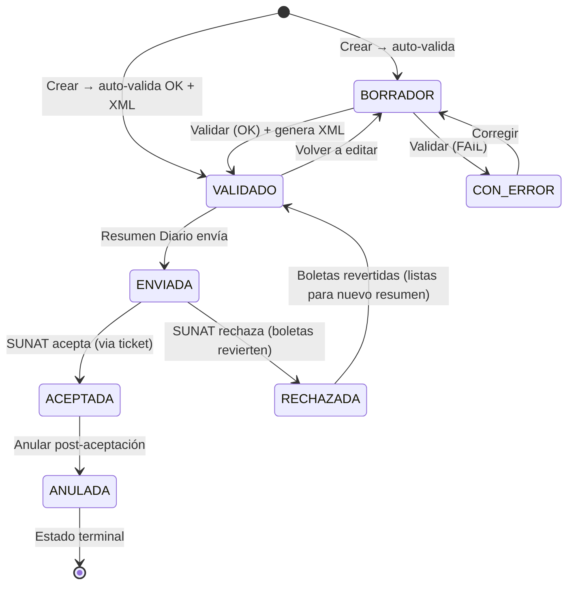
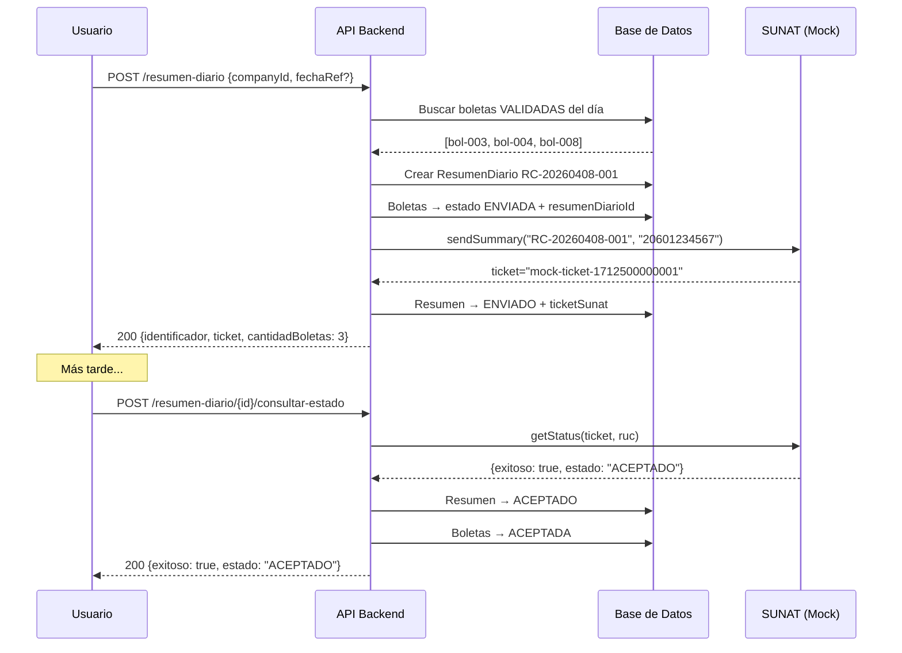

# 🎫 Escenarios de Prueba — BOLETA DE VENTA

> **Fecha:** 2026-04-08 | **Versión:** 1.0  
> **Tipo documento SUNAT:** `03` — Boleta de Venta  
> **Serie válida:** `B001`, `B002`, … (1 letra `B` + 3 dígitos)  
> **Cliente:** DNI (1), C.E. (4), Pasaporte (7) — o anónimo  
> **Emisión a SUNAT:** vía **Resumen Diario** (no directo)

---

## Referencia Rápida

### Máquina de Estados — Boleta



### Flujo Boleta vs Factura — Diferencias Clave

| Aspecto | Factura | Boleta |
|---------|---------|--------|
| Emisión a SUNAT | **Directa** (endpoint propio) | **Indirecta** vía Resumen Diario |
| Cliente obligatorio | ✅ Sí (RUC) | ❌ Opcional (anónimo permitido) |
| Tipo doc. cliente | Solo `6` (RUC) | Solo `1` (DNI), `4` (C.E.), `7` (Pasaporte) |
| XML generado al… | Emitir (`ENVIADA`) | Validar (`VALIDADO`) |
| Código tipo | `01` | `03` |
| Serie empieza con | `F` | `B` |
| Estado post-creación | `BORRADOR` (o `ENVIADA` con emitir=true) | `BORRADOR` → auto-valida → `VALIDADO`/`CON_ERROR` |

### Flujo del Resumen Diario



### Fórmula de Totales SUNAT

```
PayableAmount = Gravadas + IGV + TotalCargos − TotalDescuentos
              (tolerancia ±0.01 por redondeo)
```

### Datos de Prueba Base

| ID | Cliente | Doc | Número | Apto para boleta |
|----|---------|-----|--------|------------------|
| `cli-demo-002` | María García Pérez | DNI (1) | 45678912 | ✅ |
| `cli-demo-004` | Jean Pierre Dupont | C.E. (4) | 001234567 | ✅ |
| `cli-demo-005` | Akira Tanaka | Pasaporte (7) | JP4567890 | ✅ |
| `cli-demo-008` | Carlos Mendoza | DNI (1) | 78901234 | ✅ |
| `cli-demo-010` | Rosa Huamán | DNI (1) | 12345678 | ✅ |
| `cli-demo-001` | INVERSIONES TECH S.A.C. | RUC (6) | 20505050501 | ❌ Solo factura |
| (anónimo) | CLIENTE VARIOS | `-` | 00000000 | ✅ Default automático |

### Boletas Seed Data

| ID | Serie | Nro | Estado | Cliente | Total |
|----|-------|-----|--------|---------|-------|
| `bol-demo-001` | B001 | 1 | ACEPTADA | cli-demo-002 | S/ 413.00 |
| `bol-demo-002` | B001 | 2 | BORRADOR | cli-demo-002 | S/ 2,950.00 |
| `bol-demo-003` | B001 | 3 | VALIDADO | cli-demo-008 | S/ 212.40 |
| `bol-demo-004` | B001 | 4 | VALIDADO | cli-demo-010 | S/ 531.00 |
| `bol-demo-005` | B001 | 5 | CON_ERROR | cli-demo-002 | S/ 75.00 |
| `bol-demo-006` | B001 | 6 | ENVIADA | cli-demo-008 | S/ 944.00 |
| `bol-demo-007` | B001 | 7 | ACEPTADA | cli-demo-010 | S/ 1,416.00 |
| `bol-demo-008` | B001 | 8 | VALIDADO | cli-demo-002 | S/ 377.60 |

---

## 🟢 HAPPY PATHS

### BOL-HP-001 — Crear boleta con auto-validación exitosa → VALIDADO

| Campo | Valor |
|-------|-------|
| **Precondición** | Empresa activa, cliente con DNI |
| **Endpoint** | `POST /api/v1/boleta` |
| **Datos clave** | `moneda: PEN`, `formaPago: CONTADO`, 1 ítem gravado, cliente DNI |

**Flujo:**
1. `POST /boleta` con 1 ítem (Corte de cabello S/ 120.00)
2. Backend: correlativo B001-3 → defaults UBL → persiste como `BORRADOR`
3. Auto-valida vía `DocumentValidatorService.validarBoleta()` → resultado OK
4. Estado → `VALIDADO`, genera XML UBL tipo `03`, persiste en disco + BD

**Resultado esperado:**
- HTTP 200
- Estado: `VALIDADO` (no BORRADOR)
- `xmlContent`: XML UBL 2.1 con `<InvoiceTypeCode>03</InvoiceTypeCode>`
- `xmlPath`: `20601234567/03/B001/00000003/…`
- Notificación: "Boleta B001-00000003 guardada — VALIDADO"

---

### BOL-HP-002 — Crear boleta con cliente DNI (tipo `1`)

| Campo | Valor |
|-------|-------|
| **Datos clave** | `clientId: "cli-demo-002"` (María García, DNI 45678912) |

**Resultado esperado:**
- ✅ Validación tipo documento pasa
- XML: `<cbc:ID schemeID="1">45678912</cbc:ID>` en CustomerParty

---

### BOL-HP-003 — Crear boleta con cliente Carnet de Extranjería (tipo `4`)

| Campo | Valor |
|-------|-------|
| **Datos clave** | `clientId: "cli-demo-004"` (Jean Pierre Dupont, C.E. 001234567) |

**Resultado esperado:**
- ✅ Tipo `4` permitido para boleta
- XML: `<cbc:ID schemeID="4">001234567</cbc:ID>`

---

### BOL-HP-004 — Crear boleta con cliente Pasaporte (tipo `7`)

| Campo | Valor |
|-------|-------|
| **Datos clave** | `clientId: "cli-demo-005"` (Akira Tanaka, Pasaporte JP4567890) |

**Resultado esperado:**
- ✅ Tipo `7` permitido para boleta
- XML: `<cbc:ID schemeID="7">JP4567890</cbc:ID>`

---

### BOL-HP-005 — Crear boleta sin cliente (anónimo)

| Campo | Valor |
|-------|-------|
| **Datos clave** | `clientId: null` o vacío |

**Resultado esperado:**
- ✅ Cliente anónimo permitido en boletas (SUNAT lo permite)
- XML genera cliente por defecto:
  - Tipo: `-`, Número: `00000000`, Nombre: `CLIENTE VARIOS`, País: `PE`
- Validación del tipo de documento **no se ejecuta** cuando clientId es vacío

---

### BOL-HP-006 — Crear boleta multi-ítem

| Campo | Valor |
|-------|-------|
| **Datos clave** | 2 ítems: Servicio A (S/ 120) + Producto B (S/ 60) |

**Flujo:** Ver `bol-demo-003` en seed data.

**Resultado esperado:**
- XML con 2 `<cac:InvoiceLine>`, IDs 1 y 2
- Total: gravadas + IGV de ambos ítems

---

### BOL-HP-007 — Crear boleta a CRÉDITO con cuotas

| Campo | Valor |
|-------|-------|
| **Datos clave** | `formaPago: CREDITO`, `fechaVencimiento: 2026-05-08`, cuotas |

**Resultado esperado:**
- ✅ Cuotas persistidas en `cuotas_credito` con `boletaId`
- XML con `<cac:PaymentTerms>` por cuota
- Fecha vencimiento > emisión validada

---

### BOL-HP-008 — Actualizar borrador CON_ERROR → corregir → VALIDADO

| Campo | Valor |
|-------|-------|
| **Precondición** | Boleta `bol-demo-005` en CON_ERROR |
| **Endpoint** | `PUT /api/v1/boleta/{boletaId}/actualizar` |

**Flujo:**
1. `bol-demo-005` tiene errores: IGV=0 no coincide con tipoAfectación=10
2. `PUT /boleta/bol-demo-005/actualizar` con montos corregidos (gravadas=63.56, igv=11.44, total=75.00)
3. Backend: valida estado editable ✅ → actualiza → re-valida → OK
4. Estado → `VALIDADO`, genera XML

**Resultado esperado:**
- HTTP 200
- Estado: `VALIDADO` (antes era CON_ERROR)
- `erroresValidacion`: null (limpiado)
- XML generado

---

### BOL-HP-009 — Validar boleta manualmente → VALIDADO

| Campo | Valor |
|-------|-------|
| **Precondición** | Boleta en BORRADOR o CON_ERROR |
| **Endpoint** | `POST /api/v1/boleta/{boletaId}/validar` |

**Resultado esperado:**
- `valid: true`, `errores: []`
- Estado: `VALIDADO`
- XML generado

---

### BOL-HP-010 — Eliminar borrador de boleta

| Campo | Valor |
|-------|-------|
| **Precondición** | Boleta en BORRADOR o CON_ERROR |
| **Endpoint** | `DELETE /api/v1/boleta?boletaId={id}` |

**Resultado esperado:**
- HTTP 200 — boleta, cuotas y cargos eliminados
- Solo permitido en BORRADOR / CON_ERROR

---

### BOL-HP-011 — Descargar XML de boleta VALIDADA

| Campo | Valor |
|-------|-------|
| **Precondición** | Boleta en VALIDADO con XML generado |
| **Endpoint** | `GET /api/v1/boleta/{boletaId}/xml` |

**Resultado esperado:**
- HTTP 200 con `Content-Type: application/xml`
- `Content-Disposition: attachment; filename="20601234567-03-B001-00000003.xml"`
- XML UBL tipo `03`

---

### BOL-HP-012 — Anular boleta

| Campo | Valor |
|-------|-------|
| **Precondición** | Boleta en ACEPTADA |
| **Endpoint** | `PUT /api/v1/boleta/{boletaId}/anular` |

**Resultado esperado:**
- Estado: `ANULADA`
- Notificación creada

---

---

## 📨 RESUMEN DIARIO (BOL-RD)

### BOL-RD-001 — Crear resumen diario con boletas VALIDADAS del día

| Campo | Valor |
|-------|-------|
| **Precondición** | Existen boletas VALIDADAS para la fecha de referencia |
| **Endpoint** | `POST /api/v1/resumen-diario` |
| **Datos clave** | `{ companyId: "cmp-demo-001", fechaReferencia: "2026-04-08" }` |

**Flujo:**
1. Backend busca boletas donde `estado=VALIDADO` y `fechaEmision=2026-04-08`
2. Encuentra: `bol-demo-008` (S/ 377.60)
3. Genera identificador: `RC-20260408-001` (conteo del día + 1)
4. Crea `ResumenDiarioEntity` → estado `GENERADO`
5. Boletas → `estado=ENVIADA`, `resumenDiarioId=rd-xxx`
6. Envía a SUNAT mock → ticket → estado `ENVIADO`

**Resultado esperado:**
- HTTP 200
- `identificador: "RC-20260408-001"`
- `estado: "ENVIADO"`
- `ticketSunat: "mock-ticket-xxxxx"`
- `cantidadBoletas: 1`
- Boleta `bol-demo-008` ahora está en `ENVIADA`
- Notificación: "Resumen Diario RC-20260408-001 — 1 boletas — ENVIADO"

---

### BOL-RD-002 — Crear resumen diario con boletaIds específicos

| Campo | Valor |
|-------|-------|
| **Datos clave** | `{ companyId: "...", boletaIds: ["bol-demo-003", "bol-demo-004"] }` |

**Flujo:**
1. Backend busca cada boleta por ID
2. Filtra solo las que están en `VALIDADO`
3. Crea resumen con las 2 boletas

**Resultado esperado:**
- `cantidadBoletas: 2`
- Ambas boletas → ENVIADA

---

### BOL-RD-003 — Múltiples resúmenes el mismo día

| Campo | Valor |
|-------|-------|
| **Precondición** | Ya existe `RC-20260408-001` |
| **Acción** | Crear otro resumen para el mismo día |

**Resultado esperado:**
- Nuevo identificador: `RC-20260408-002` (correlativo incrementa)
- `countByCompanyIdAndFechaGeneracion()` retorna 1 → correlativo = 002

---

### BOL-RD-004 — Consultar estado → ACEPTADO

| Campo | Valor |
|-------|-------|
| **Precondición** | Resumen en ENVIADO con ticket |
| **Endpoint** | `POST /api/v1/resumen-diario/{resumenId}/consultar-estado` |

**Flujo:**
1. `POST /resumen-diario/rd-demo-002/consultar-estado`
2. Backend llama `sunatSoapClient.getStatus(ticket, ruc)`
3. Mock retorna: `exitoso=true, estado="ACEPTADO", código="0"`
4. Resumen → `ACEPTADO`
5. Todas las boletas asociadas → `ACEPTADA`
6. Notificación: "Resumen RC-20260406-001 ACEPTADO por SUNAT"

**Resultado esperado:**
- `exitoso: true`, `estado: "ACEPTADO"`
- Boleta `bol-demo-006` → ACEPTADA

---

### BOL-RD-005 — Consultar estado → RECHAZADO

| Campo | Valor |
|-------|-------|
| **Precondición** | Resumen en ENVIADO |
| **Escenario mock** | `getStatus()` retorna `estado="RECHAZADO"` |

**Flujo (cuando se implemente SUNAT real):**
1. SUNAT rechaza el resumen
2. Resumen → `RECHAZADO`
3. Boletas asociadas → **revierten a `VALIDADO`** + `resumenDiarioId = null`
4. Las boletas quedan disponibles para un nuevo resumen

**Resultado esperado:**
- Resumen: RECHAZADO
- Boletas: VALIDADO (desvinculadas)
- Las boletas se pueden incluir en un nuevo resumen

---

### BOL-RD-006 — Listar resúmenes diarios

| Campo | Valor |
|-------|-------|
| **Endpoint** | `GET /api/v1/resumen-diario?companyId=cmp-demo-001` |

**Resultado esperado:**
- HTTP 200 con lista ordenada por `fechaGeneracion` DESC
- Incluye paginación
- Seed data: `rd-demo-001` (ACEPTADO), `rd-demo-002` (ENVIADO)

---

### BOL-RD-007 — Obtener detalle de resumen diario

| Campo | Valor |
|-------|-------|
| **Endpoint** | `GET /api/v1/resumen-diario/{resumenId}` |

**Resultado esperado:**
- HTTP 200 con `ResumenDiarioData` completo
- Incluye lista de `boletas[]` asociadas

---

---

## 🔴 UNHAPPY PATHS

### BOL-UP-001 — Serie de factura usada en boleta

| Campo | Valor |
|-------|-------|
| **Datos clave** | `serie: "F001"` en endpoint de boleta |

**Resultado esperado:**
- HTTP 400 — `"La serie de una boleta debe iniciar con 'B'"`
- Validación: `SunatValidator.validarSerieBoleta()`

---

### BOL-UP-002 — Serie formato inválido

| Campo | Valor |
|-------|-------|
| **Datos clave** | `serie: "BB01"`, `"B01"`, `"b001"` |

**Resultado esperado:**
- HTTP 400 — `"Formato de serie inválido"`
- Regex: `^[A-Z]\d{3}$`

---

### BOL-UP-003 — Cliente con RUC en boleta

| Campo | Valor |
|-------|-------|
| **Datos clave** | `clientId: "cli-demo-001"` (INVERSIONES TECH, RUC tipo `6`) |

**Resultado esperado:**
- HTTP 400 — `"Para una Boleta, el cliente debe tener DNI ('1'), Carnet de Extranjería ('4') o Pasaporte ('7'). Tipo recibido: '6'"`
- Validación: `SunatValidator.validarTipoDocumentoCliente("BOLETA", "6")`

---

### BOL-UP-004 — Detalle vacío

| Campo | Valor |
|-------|-------|
| **Datos clave** | `detalle: []` |

**Resultado esperado:**
- HTTP 400 — `"El comprobante debe tener al menos un ítem en el detalle"`

---

### BOL-UP-005 — Montos negativos

| Campo | Valor |
|-------|-------|
| **Datos clave** | `gravadas: -500, igv: -90, total: -590` |

**Resultado esperado:**
- HTTP 400 — 3 errores de montos negativos

---

### BOL-UP-006 — Total no cuadra

| Campo | Valor |
|-------|-------|
| **Datos clave** | `gravadas: 100, igv: 18, total: 200` (esperado: 118) |

**Resultado esperado:**
- HTTP 400 — `"El total (200) debe ser igual a gravadas (100) + IGV (18). Esperado: 118.00"`

---

### BOL-UP-007 — Moneda USD sin tipo de cambio

| Campo | Valor |
|-------|-------|
| **Datos clave** | `moneda: "USD"`, `tipoCambio: null` |

**Resultado esperado:**
- HTTP 400 — `"Cuando la moneda es USD, el tipo de cambio es obligatorio"`

---

### BOL-UP-008 — Fecha de emisión futura

| Campo | Valor |
|-------|-------|
| **Datos clave** | `fechaEmision: "2027-01-01"` |

**Resultado esperado:**
- HTTP 400 — `"La fecha de emisión no puede ser posterior a la fecha actual"`

---

### BOL-UP-009 — Actualizar boleta en estado ENVIADA

| Campo | Valor |
|-------|-------|
| **Precondición** | Boleta `bol-demo-006` en ENVIADA |
| **Endpoint** | `PUT /api/v1/boleta/{boletaId}/actualizar` |

**Resultado esperado:**
- HTTP 400 — `"Solo se pueden actualizar boletas en estado BORRADOR, VALIDADO o CON_ERROR. Estado actual: ENVIADA"`

---

### BOL-UP-010 — Actualizar boleta ACEPTADA

| Campo | Valor |
|-------|-------|
| **Precondición** | Boleta `bol-demo-001` en ACEPTADA |

**Resultado esperado:**
- HTTP 400 — mismo rechazo

---

### BOL-UP-011 — Eliminar boleta ENVIADA

| Campo | Valor |
|-------|-------|
| **Precondición** | Boleta en ENVIADA |
| **Endpoint** | `DELETE /api/v1/boleta?boletaId={id}` |

**Resultado esperado:**
- HTTP 400 — `"Solo los comprobantes en estado BORRADOR o CON_ERROR pueden eliminarse"`

---

### BOL-UP-012 — Eliminar boleta ACEPTADA

| Campo | Valor |
|-------|-------|
| **Precondición** | Boleta en ACEPTADA |

**Resultado esperado:**
- HTTP 400 — mismo rechazo

---

### BOL-UP-013 — Validar boleta en estado ENVIADA

| Campo | Valor |
|-------|-------|
| **Precondición** | Boleta en ENVIADA |
| **Endpoint** | `POST /api/v1/boleta/{boletaId}/validar` |

**Resultado esperado:**
- HTTP 400 — `"Solo se pueden validar boletas en estado BORRADOR, VALIDADO o CON_ERROR"`

---

### BOL-UP-014 — Boleta no encontrada

| Campo | Valor |
|-------|-------|
| **Datos clave** | `boletaId: "bol-no-existe"` |

**Resultado esperado:**
- HTTP 404 — `ResourceNotFoundException`

---

### BOL-UP-015 — Descargar XML de boleta BORRADOR (sin XML)

| Campo | Valor |
|-------|-------|
| **Precondición** | Boleta en BORRADOR, auto-validación falló → `CON_ERROR` → sin XML |
| **Endpoint** | `GET /api/v1/boleta/{boletaId}/xml` |

**Resultado esperado:**
- HTTP 204 No Content

---

### BOL-UP-016 — CRÉDITO sin fecha de vencimiento

| Campo | Valor |
|-------|-------|
| **Datos clave** | `formaPago: "CREDITO"`, `fechaVencimiento: null` |

**Resultado esperado:**
- HTTP 400 — `"Forma de pago CRÉDITO requiere una fecha de vencimiento"`

---

### BOL-UP-017 — Campos monetarios null

| Campo | Valor |
|-------|-------|
| **Datos clave** | `gravadas: null, igv: null, total: null` |

**Resultado esperado:**
- HTTP 400 — 3 errores: monto gravado, IGV, total obligatorios

---

### BOL-UP-018 — JSON detalle corrupto

| Campo | Valor |
|-------|-------|
| **Datos clave** | Detalle JSON mal formado: `"{ not valid json }"` |

**Resultado esperado:**
- Validación interna falla: `"Error al parsear el detalle JSON: …"`
- Estado: CON_ERROR con erroresValidacion poblado

---

---

## 📨🔴 RESUMEN DIARIO — UNHAPPY PATHS

### BOL-RD-UP-001 — Crear resumen sin boletas VALIDADAS

| Campo | Valor |
|-------|-------|
| **Precondición** | No hay boletas VALIDADAS para la fecha indicada |
| **Endpoint** | `POST /api/v1/resumen-diario` |
| **Datos clave** | `{ companyId: "cmp-demo-001", fechaReferencia: "2026-01-01" }` (sin boletas) |

**Resultado esperado:**
- HTTP 400 — `"No hay boletas VALIDADAS para incluir en el resumen diario"`
- `SunatValidationException`

---

### BOL-RD-UP-002 — Crear resumen con boletaId no encontrado

| Campo | Valor |
|-------|-------|
| **Datos clave** | `boletaIds: ["bol-no-existe"]` |

**Resultado esperado:**
- HTTP 404 — `ResourceNotFoundException("Boleta", "bol-no-existe")`

---

### BOL-RD-UP-003 — Crear resumen con boleta que no está en VALIDADO

| Campo | Valor |
|-------|-------|
| **Datos clave** | `boletaIds: ["bol-demo-002"]` (estado BORRADOR, no VALIDADO) |

**Resultado esperado:**
- La boleta se filtra (`.filter(b -> "VALIDADO".equals(b.getEstado()))`)
- Si después del filtro `boletas.isEmpty()` → HTTP 400: "No hay boletas VALIDADAS"

---

### BOL-RD-UP-004 — Consultar estado de resumen sin ticket

| Campo | Valor |
|-------|-------|
| **Precondición** | Resumen creado pero envío SUNAT falló → sin ticket |
| **Endpoint** | `POST /api/v1/resumen-diario/{resumenId}/consultar-estado` |

**Resultado esperado:**
- HTTP 400 — `"El resumen no tiene ticket SUNAT asignado"`

---

### BOL-RD-UP-005 — Envío a SUNAT falla → resumen CON_ERROR

| Campo | Valor |
|-------|-------|
| **Escenario** | `sunatSoapClient.sendSummary()` retorna `exitoso=false` |

**Resultado esperado:**
- Resumen → estado `CON_ERROR`
- `descripcionRespuesta`: mensaje de error del mock/SUNAT
- Boletas ya están en `ENVIADA` (se marcaron antes del envío) — **issue potencial**

---

### BOL-RD-UP-006 — Resumen diario no encontrado

| Campo | Valor |
|-------|-------|
| **Datos clave** | `resumenId: "rd-no-existe"` |

**Resultado esperado:**
- HTTP 404 — `ResourceNotFoundException`

---

### BOL-RD-UP-007 — Empresa no encontrada al crear resumen

| Campo | Valor |
|-------|-------|
| **Datos clave** | `companyId: "cmp-inexistente"` |

**Resultado esperado:**
- HTTP 404 — `ResourceNotFoundException("Empresa", "cmp-inexistente")`

---

---

## 🟡 EDGE CASES

### BOL-EC-001 — Boleta VALIDADO editada → re-valida → sigue VALIDADO

| Campo | Valor |
|-------|-------|
| **Precondición** | Boleta `bol-demo-003` en VALIDADO (con XML generado) |
| **Acción** | `PUT /boleta/bol-demo-003/actualizar` con datos ligeramente diferentes |

**Resultado esperado:**
- Re-validación ejecutada
- Si pasa: estado sigue `VALIDADO`, **nuevo XML generado** (reemplaza anterior)
- El `xmlPath` puede cambiar

---

### BOL-EC-002 — Boleta CON_ERROR corregida genera nuevo XML

| Campo | Valor |
|-------|-------|
| **Precondición** | Boleta `bol-demo-005` CON_ERROR → sin XML |
| **Acción** | Actualizar con datos correctos |

**Resultado esperado:**
- Pasa validación → VALIDADO
- XML generado por primera vez
- `erroresValidacion` limpiado a null

---

### BOL-EC-003 — Resumen rechazado → boletas disponibles para nuevo resumen

| Campo | Valor |
|-------|-------|
| **Precondición** | Resumen RECHAZADO por SUNAT |
| **Flujo post-rechazo** |

**Resultado esperado:**
1. Consulta estado → RECHAZADO
2. Boletas → VALIDADO + `resumenDiarioId = null` (desvinculadas)
3. Ahora esas boletas aparecen en la búsqueda de "VALIDADAS" del día
4. Se puede crear un nuevo resumen que las incluya

---

### BOL-EC-004 — Cliente anónimo en XML

| Campo | Valor |
|-------|-------|
| **Precondición** | Boleta creada sin `clientId` |

**Resultado esperado:**
- XML genera:
  ```xml
  <cac:AccountingCustomerParty>
    <cac:Party>
      <cac:PartyIdentification>
        <cbc:ID schemeID="-">00000000</cbc:ID>
      </cac:PartyIdentification>
      <cac:PartyLegalEntity>
        <cbc:RegistrationName>CLIENTE VARIOS</cbc:RegistrationName>
      </cac:PartyLegalEntity>
    </cac:Party>
  </cac:AccountingCustomerParty>
  ```
- CodigoPais: `PE`

---

### BOL-EC-005 — CONTADO auto-asigna fechaVencimiento = fechaEmision

| Campo | Valor |
|-------|-------|
| **Datos clave** | `formaPago: null` (default) o `formaPago: "CONTADO"` |

**Resultado esperado:**
- Backend asigna: `formaPago = "CONTADO"` si null
- `fechaVencimiento = fechaEmision`

---

### BOL-EC-006 — Boleta sin formaPago explícita (default CONTADO)

| Campo | Valor |
|-------|-------|
| **Datos clave** | `formaPago` no enviado en el payload |

**Resultado esperado:**
- Default a `"CONTADO"`
- `fechaVencimiento = fechaEmision`

---

### BOL-EC-007 — Tolerancia de redondeo ±0.01 en boleta

| Campo | Valor |
|-------|-------|
| **Datos clave** | Gravadas=100.33, IGV=18.06, Total=118.40 (esperado 118.39, diff=0.01) |

**Resultado esperado:**
- ✅ Pasa validación (tolerancia exactamente 0.01)
- Si diff=0.02 → CON_ERROR

---

### BOL-EC-008 — Resumen diario con boletas de diferentes fechas

| Campo | Valor |
|-------|-------|
| **Datos clave** | `boletaIds: ["bol-demo-003", "bol-demo-008"]` (fechas 2026-04-07 y 2026-04-08) |

**Resultado esperado:**
- ✅ Se permite — el filtro por `boletaIds` específicos no valida por fecha
- Solo filtra por estado `VALIDADO`

---

### BOL-EC-009 — Error generando XML (catch silencioso)

| Campo | Valor |
|-------|-------|
| **Escenario** | Error inesperado en `UblInvoiceXmlBuilder.buildBoletaXml()` |

**Resultado esperado:**
- Log de error: `"Error generando XML para boleta B001-xxx"`
- `xmlContent` y `xmlPath` quedan null
- **Boleta se guarda de todas formas** (try-catch en `generateBoletaXml`)
- Estado sigue como `VALIDADO` (la validación pasó, solo falló el XML)

---

### BOL-EC-010 — PEN con tipo de cambio informado (advertencia)

| Campo | Valor |
|-------|-------|
| **Datos clave** | `moneda: "PEN"`, `tipoCambio: 3.752` |

**Resultado esperado:**
- ✅ No bloquea
- Advertencia: `"Se informó tipo de cambio (3.752) pero la moneda es PEN — será ignorado"`

---

---

## 📊 Resumen de Códigos

| Código | Tipo | Total |
|--------|------|-------|
| `BOL-HP-001..012` | Happy Path | 12 |
| `BOL-RD-001..007` | Resumen Diario Happy | 7 |
| `BOL-UP-001..018` | Unhappy Path | 18 |
| `BOL-RD-UP-001..007` | Resumen Diario Unhappy | 7 |
| `BOL-EC-001..010` | Edge Case | 10 |
| **TOTAL** | | **54** |

