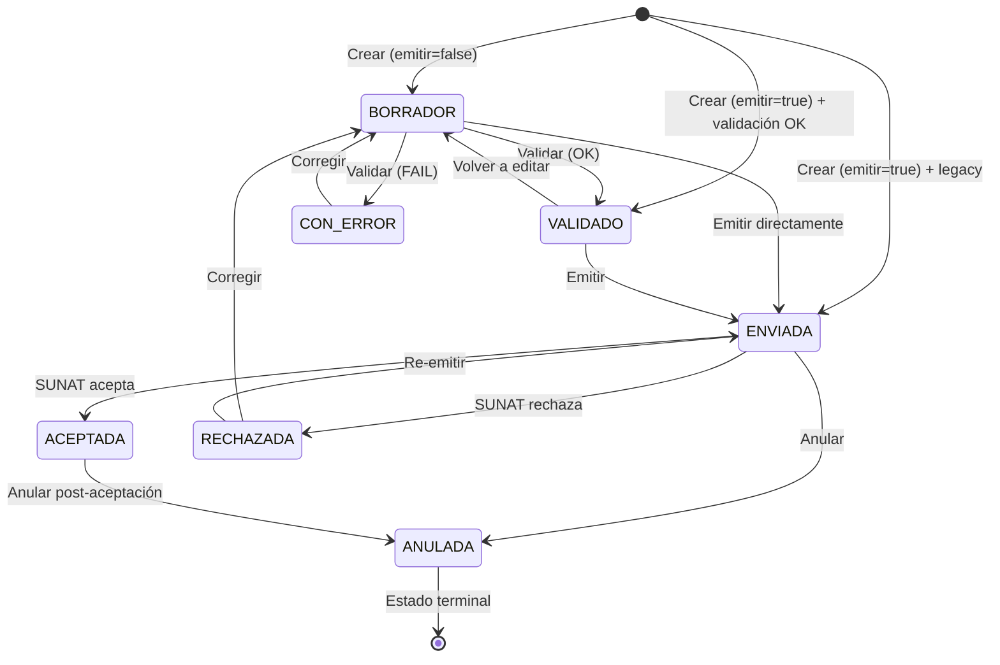

# 🧾 Escenarios de Prueba — FACTURA ELECTRÓNICA

> **Fecha:** 2026-04-08 | **Versión:** 1.0  
> **Tipo documento SUNAT:** `01` — Factura  
> **Serie válida:** `F001`, `F002`, … (1 letra `F` + 3 dígitos)  
> **Cliente obligatorio:** RUC (tipo documento `6`)

---

## Referencia Rápida

### Máquina de Estados — Factura



### Fórmula de Totales SUNAT

```
PayableAmount = Gravadas + IGV + TotalCargos − TotalDescuentos
              = TaxableAmount + TaxAmount + Charges − Allowances
              (tolerancia ±0.01 por redondeo)
```

### Catálogos SUNAT Involucrados

| Cat. | Nombre | Valores ejemplo |
|------|--------|-----------------|
| 01 | Tipo documento | `01` = Factura |
| 02 | Moneda | `PEN`, `USD` |
| 03 | Unidad medida | `NIU` (unidad), `ZZ` (servicio), `MON` (mes) |
| 05 | Tipo tributo | `1000` (IGV), `9997` (EXO), `9998` (INA), `9996` (GRA) |
| 06 | Tipo doc. identidad | `6` (RUC) — obligatorio para facturas |
| 07 | Afectación IGV | `10` (gravado), `20` (exonerado), `30` (inafecto) |
| 13 | Ubigeo | `150131` (San Isidro), `080108` (Wanchaq) |
| 16 | Tipo precio | `01` (con IGV), `02` (referencial) |
| 51 | Tipo operación | `0101` (venta interna), `0200` (exportación) |
| 52 | Leyendas | `1000` (monto en letras) |
| 53 | Cargos/Descuentos | `00` (desc. global), `46` (recargo consumo), `02` (desc. NO afecta base) |

### Datos de Prueba Base

| ID | Empresa | RUC |
|----|---------|-----|
| `cmp-demo-001` | ETLIONS S.A.C. | 20601234567 |

| ID | Cliente | Doc | Número | Apto para factura |
|----|---------|-----|--------|-------------------|
| `cli-demo-001` | INVERSIONES TECH PERU S.A.C. | RUC (6) | 20505050501 | ✅ |
| `cli-demo-003` | GLOBAL IMPORTS E.I.R.L. | RUC (6) | 20612345678 | ✅ |
| `cli-demo-006` | DISTRIBUIDORA ANDINA S.A. | RUC (6) | 20498765432 | ✅ |
| `cli-demo-002` | María García Pérez | DNI (1) | 45678912 | ❌ Solo boleta |
| `cli-demo-004` | Jean Pierre Dupont | C.E. (4) | 001234567 | ❌ Solo boleta |

---

## 🟢 HAPPY PATHS

### FAC-HP-001 — Crear factura con emisión directa (PEN, CONTADO)

| Campo | Valor |
|-------|-------|
| **Precondición** | Empresa activa, cliente con RUC, al menos 1 producto |
| **Endpoint** | `POST /api/v1/factura` |
| **Datos clave** | `emitir: true`, `moneda: PEN`, `formaPago: CONTADO`, 1 ítem gravado |

**Flujo:**
1. Usuario completa wizard con 1 ítem (Consultoría TI, ×1, S/ 2,500.00)
2. Frontend calcula: gravadas=2500, IGV=450, total=2950
3. `POST /factura` con `emitir: true`
4. Backend: correlativo automático → validación SUNAT → genera XML UBL 2.1 → persiste → estado `ENVIADA`

**Resultado esperado:**
- HTTP 200
- Estado: `ENVIADA` (o `EMITIDA`)
- XML generado con `<InvoiceTypeCode>01</InvoiceTypeCode>`
- `xmlContent` y `xmlPath` poblados
- Notificación creada

---

### FAC-HP-002 — Crear factura como borrador (emitir=false)

| Campo | Valor |
|-------|-------|
| **Precondición** | Empresa con `emisionEnEnvio=false` o usuario elige "Guardar Borrador" |
| **Endpoint** | `POST /api/v1/factura` |
| **Datos clave** | `emitir: false`, resto de datos completos |

**Flujo:**
1. `POST /factura` con `emitir: false`
2. Backend: correlativo automático → validaciones básicas → persiste sin XML → estado `BORRADOR`

**Resultado esperado:**
- HTTP 200
- Estado: `BORRADOR`
- `xmlContent`: null
- `xmlPath`: null
- El número se asigna inmediatamente

---

### FAC-HP-003 — Emitir borrador existente

| Campo | Valor |
|-------|-------|
| **Precondición** | Factura en estado `BORRADOR` o `VALIDADO` |
| **Endpoint** | `PUT /api/v1/factura/{facturaId}/emitir` |

**Flujo:**
1. Factura `fac-demo-018` en BORRADOR
2. `PUT /factura/fac-demo-018/emitir`
3. Backend: re-valida → genera XML → guarda en disco + BD → transiciona a `ENVIADA`

**Resultado esperado:**
- HTTP 200
- Estado: `ENVIADA`
- XML generado correctamente
- `xmlPath` apunta a `etia_storage/20601234567/01/F001/…`

---

### FAC-HP-004 — Crear factura en USD con tipo de cambio

| Campo | Valor |
|-------|-------|
| **Precondición** | Tipo de cambio disponible para la fecha |
| **Endpoint** | `POST /api/v1/factura` |
| **Datos clave** | `moneda: USD`, `tipoCambio: 3.752`, 1 ítem US$ 1,000.00 |

**Flujo:**
1. Wizard detecta moneda USD → consulta tipo de cambio del día → 3.752
2. `POST /factura` con moneda=USD, tipoCambio=3.752
3. Cálculo: gravadas=1000, IGV=180, total=1180
4. XML incluye `<DocumentCurrencyCode>USD</DocumentCurrencyCode>`

**Resultado esperado:**
- HTTP 200
- XML con moneda USD y tipo de cambio en metadata

---

### FAC-HP-005 — Crear factura a CRÉDITO con cuotas

| Campo | Valor |
|-------|-------|
| **Precondición** | Forma de pago CRÉDITO, fecha vencimiento > emisión |
| **Endpoint** | `POST /api/v1/factura` |
| **Datos clave** | `formaPago: CREDITO`, `fechaVencimiento: 2026-05-15`, 3 cuotas |

**Flujo:**
1. Total factura: S/ 8,850.00 → 3 cuotas de S/ 2,950.00
2. Payload incluye `cuotas: [{numeroCuota: "Cuota001", monto: 2950, fechaVencimiento: "2026-04-15"}, ...]`
3. Backend: persiste factura → persiste cuotas en `cuotas_credito` → genera XML con `<cac:PaymentTerms>`

**Resultado esperado:**
- 3 registros en `cuotas_credito` vinculados a la factura
- XML contiene secciones `PaymentTerms` por cada cuota

---

### FAC-HP-006 — Crear factura con cargos y descuentos globales (Cat. 53)

| Campo | Valor |
|-------|-------|
| **Precondición** | Ítems con subtotal base, cargos/descuentos configurados |
| **Endpoint** | `POST /api/v1/factura` |
| **Datos clave** | Descuento global 5% (código `00`) + Recargo consumo 10% (código `46`) |

**Flujo:**
1. 3 ítems → subtotal gravado: S/ 5,530.00
2. Descuento global: 5% × 5530 = S/ 276.50
3. Recargo consumo: 10% × 5530 = S/ 553.00
4. Total: 5530 + 995.40 (IGV) + 553 − 276.50 = S/ 6,801.90

**Resultado esperado:**
- Registros en `allowance_charges` vinculados
- XML contiene `<cac:AllowanceCharge>` con `ChargeIndicator` true/false
- Total cuadra con fórmula SUNAT

---

### FAC-HP-007 — Crear factura multi-ítem con diferentes afectaciones IGV

| Campo | Valor |
|-------|-------|
| **Precondición** | Productos con distintas afectaciones tributarias |
| **Endpoint** | `POST /api/v1/factura` |
| **Datos clave** | 1 ítem gravado (Cat.07=10) + 1 exonerado (Cat.07=20) + 1 inafecto (Cat.07=30) |

**Flujo:**
1. Ítem 1: Laptop S/ 4,200 (gravado → IGV 756) | Ítem 2: Libro S/ 50 (exonerado → IGV 0) | Ítem 3: Seguro S/ 200 (inafecto → IGV 0)
2. Gravadas=4200, Exoneradas=50, Inafectas=200, IGV=756, Total=5206

**Resultado esperado:**
- XML con 3 `TaxSubtotal`: `1000` (IGV), `9997` (EXO), `9998` (INA)
- `TaxExemptionReasonCode` por ítem: 10, 20, 30

---

### FAC-HP-008 — Actualizar borrador exitoso

| Campo | Valor |
|-------|-------|
| **Precondición** | Factura en estado `BORRADOR` o `CON_ERROR` o `VALIDADO` |
| **Endpoint** | `PUT /api/v1/factura/{facturaId}/actualizar` |

**Flujo:**
1. Factura `fac-demo-018` en BORRADOR con 1 ítem
2. `PUT /factura/fac-demo-018/actualizar` con nuevo clientId, 3 ítems, monto corregido
3. Backend: valida estado editable → actualiza campos → reemplaza cuotas/cargos → re-valida

**Resultado esperado:**
- HTTP 200
- Datos actualizados reflejados
- Serie y número **no cambian**
- Estado se mantiene o transiciona según re-validación

---

### FAC-HP-009 — Validar factura manualmente → VALIDADO

| Campo | Valor |
|-------|-------|
| **Precondición** | Factura en BORRADOR con datos completos y correctos |
| **Endpoint** | `POST /api/v1/factura/{facturaId}/validar` |

**Flujo:**
1. `POST /factura/fac-demo-018/validar`
2. `DocumentValidatorService.validarFactura()` ejecuta 10+ reglas
3. Todas pasan → estado `VALIDADO`, `erroresValidacion` = null

**Resultado esperado:**
- `valid: true`, `errores: []`
- Estado cambia a `VALIDADO`

---

### FAC-HP-010 — Anular factura ACEPTADA

| Campo | Valor |
|-------|-------|
| **Precondición** | Factura en estado `ACEPTADA` |
| **Endpoint** | `PUT /api/v1/factura?facturaId={id}` |
| **Datos clave** | `motivoAnulacion: "Error en datos del cliente"` |

**Flujo:**
1. Factura `fac-demo-001` en ACEPTADA
2. `PUT /factura?facturaId=fac-demo-001` con motivo
3. Backend valida: ACEPTADA → ANULADA (permitido)

**Resultado esperado:**
- Estado: `ANULADA`
- Notificación de anulación creada

---

### FAC-HP-011 — Anular factura ENVIADA

| Campo | Valor |
|-------|-------|
| **Precondición** | Factura en estado `ENVIADA` |
| **Endpoint** | `PUT /api/v1/factura?facturaId={id}` |

**Resultado esperado:**
- Estado: `ANULADA` (ENVIADA → ANULADA es válido)

---

### FAC-HP-012 — Eliminar borrador

| Campo | Valor |
|-------|-------|
| **Precondición** | Factura en estado `BORRADOR` o `CON_ERROR` |
| **Endpoint** | `DELETE /api/v1/factura?facturaId={id}` |

**Flujo:**
1. `DELETE /factura?facturaId=fac-demo-018`
2. Backend: valida estado BORRADOR → elimina cuotas → elimina cargos → elimina factura

**Resultado esperado:**
- HTTP 200
- Factura eliminada de BD
- Cuotas y cargos asociados eliminados en cascada

---

### FAC-HP-013 — Descargar XML desde disco

| Campo | Valor |
|-------|-------|
| **Precondición** | Factura ENVIADA/ACEPTADA con XML persistido en `etia_storage/` |
| **Endpoint** | `GET /api/v1/factura/{facturaId}/xml` |

**Resultado esperado:**
- HTTP 200 con `Content-Type: application/xml`
- Header `Content-Disposition: attachment; filename="20601234567-01-F001-00000001.xml"`
- Contenido: XML UBL 2.1 idéntico al generado al emitir (inmutabilidad garantizada)

---

### FAC-HP-014 — Descargar XML desde BD (fallback)

| Campo | Valor |
|-------|-------|
| **Precondición** | `xmlPath` no existe en disco pero `xmlContent` está en BD |
| **Endpoint** | `GET /api/v1/factura/{facturaId}/xml` |

**Resultado esperado:**
- HTTP 200 con XML leído desde campo `xmlContent` de la BD

---

### FAC-HP-015 — Re-emitir factura RECHAZADA

| Campo | Valor |
|-------|-------|
| **Precondición** | Factura en estado `RECHAZADA` |
| **Endpoint** | `PUT /api/v1/factura/{facturaId}/emitir` |

**Flujo:**
1. Factura fue rechazada por SUNAT
2. Usuario corrige datos → actualiza borrador → emite
3. Transición: RECHAZADA → ENVIADA (permitido por `TRANSICIONES_VALIDAS`)

**Resultado esperado:**
- Estado: `ENVIADA`
- Nuevo XML generado reemplazando el anterior

---

### FAC-HP-016 — Listar facturas por empresa

| Campo | Valor |
|-------|-------|
| **Endpoint** | `GET /api/v1/factura?companyId=cmp-demo-001` |

**Resultado esperado:**
- HTTP 200 con array de `FacturaData`
- Incluye cuotas y cargos/descuentos enriquecidos
- Paginación incluida

---

### FAC-HP-017 — Obtener factura individual

| Campo | Valor |
|-------|-------|
| **Endpoint** | `GET /api/v1/factura/{facturaId}` |

**Resultado esperado:**
- HTTP 200 con `FacturaData` completo
- Incluye `detalle`, `cuotas`, `cargosDescuentos`, `xmlPath`

---

### FAC-HP-018 — Flujo completo: BORRADOR → VALIDADO → ENVIADA → ACEPTADA → ANULADA

| Campo | Valor |
|-------|-------|
| **Precondición** | Datos válidos para todo el flujo |

**Flujo:**
1. `POST /factura` con `emitir: false` → `BORRADOR`
2. `POST /factura/{id}/validar` → `VALIDADO`
3. `PUT /factura/{id}/emitir` → `ENVIADA` (genera XML)
4. (SUNAT acepta) → `ACEPTADA`
5. `PUT /factura?facturaId={id}` con motivo → `ANULADA`

**Resultado esperado:** Cada transición exitosa, XML inmutable desde paso 3.

---

## 🔴 UNHAPPY PATHS

### FAC-UP-001 — Crear factura sin companyId

| Campo | Valor |
|-------|-------|
| **Endpoint** | `POST /api/v1/factura` |
| **Datos clave** | `companyId: null` |

**Resultado esperado:**
- HTTP 400 — `"El campo 'companyId' es obligatorio"`
- Validación: `SunatValidator.validarCampoObligatorio()`

---

### FAC-UP-002 — Crear factura sin clientId

| Campo | Valor |
|-------|-------|
| **Datos clave** | `clientId: null` o vacío |

**Resultado esperado:**
- HTTP 400 — `"El campo 'clientId' es obligatorio"`

---

### FAC-UP-003 — Serie con formato inválido

| Campo | Valor |
|-------|-------|
| **Datos clave** | `serie: "FA01"`, `"F01"`, `"f001"`, `"1001"` |

**Resultado esperado:**
- HTTP 400 — `"Formato de serie inválido 'FA01'. Debe ser 1 letra mayúscula + 3 dígitos"`
- Validación: `SunatValidator.validarFormatoSerie()` — regex `^[A-Z]\d{3}$`

---

### FAC-UP-004 — Serie de boleta usada en factura

| Campo | Valor |
|-------|-------|
| **Datos clave** | `serie: "B001"` en endpoint de factura |

**Resultado esperado:**
- HTTP 400 — `"La serie de una factura debe iniciar con 'F'"`
- Validación: `SunatValidator.validarSerieFactura()`

---

### FAC-UP-005 — Cliente con DNI en vez de RUC

| Campo | Valor |
|-------|-------|
| **Datos clave** | `clientId: "cli-demo-002"` (María García, DNI tipo `1`) |

**Resultado esperado:**
- HTTP 400 — `"Para una Factura, el cliente debe tener RUC (tipo documento '6')"`
- Validación: `SunatValidator.validarTipoDocumentoCliente("FACTURA", "1")`

---

### FAC-UP-006 — Cliente con Carnet de Extranjería

| Campo | Valor |
|-------|-------|
| **Datos clave** | `clientId: "cli-demo-004"` (Jean Pierre, C.E. tipo `4`) |

**Resultado esperado:**
- HTTP 400 — mismo mensaje: RUC obligatorio para factura

---

### FAC-UP-007 — Cliente con Pasaporte

| Campo | Valor |
|-------|-------|
| **Datos clave** | `clientId: "cli-demo-005"` (Akira Tanaka, Pasaporte tipo `7`) |

**Resultado esperado:**
- HTTP 400 — mismo mensaje: RUC obligatorio para factura

---

### FAC-UP-008 — Detalle vacío (sin ítems)

| Campo | Valor |
|-------|-------|
| **Datos clave** | `detalle: []` o `detalle: null` |

**Resultado esperado:**
- HTTP 400 — `"El comprobante debe tener al menos un ítem en el detalle"`
- Validación: `SunatValidator.validarDetalleNoVacio()`

---

### FAC-UP-009 — Ítem sin descripción

| Campo | Valor |
|-------|-------|
| **Datos clave** | `detalle: [{ descripcion: "", cantidad: 1, valorUnitario: 100 }]` |

**Resultado esperado:**
- HTTP 400 — `"Ítem [1]: la descripción es obligatoria"`

---

### FAC-UP-010 — Ítem con cantidad ≤ 0

| Campo | Valor |
|-------|-------|
| **Datos clave** | `detalle: [{ descripcion: "Laptop", cantidad: 0, valorUnitario: 4200 }]` |

**Resultado esperado:**
- HTTP 400 — `"Ítem [1]: la cantidad debe ser mayor a 0"`

---

### FAC-UP-011 — Ítem con valor unitario negativo

| Campo | Valor |
|-------|-------|
| **Datos clave** | `detalle: [{ descripcion: "Desc", cantidad: 1, valorUnitario: -500 }]` |

**Resultado esperado:**
- HTTP 400 — `"Ítem [1]: el valor unitario no puede ser negativo"`

---

### FAC-UP-012 — Montos negativos (gravadas, IGV, total)

| Campo | Valor |
|-------|-------|
| **Datos clave** | `gravadas: -1000, igv: -180, total: -1180` |

**Resultado esperado:**
- HTTP 400 — `"El monto gravado no puede ser negativo: -1000"`, etc.
- Validación: `SunatValidator.validarMontosNoNegativos()`

---

### FAC-UP-013 — Total no cuadra con gravadas + IGV

| Campo | Valor |
|-------|-------|
| **Datos clave** | `gravadas: 1000, igv: 180, total: 1200` (debería ser 1180) |

**Resultado esperado:**
- HTTP 400 — `"El total (1200) debe ser igual a gravadas (1000) + IGV (180). Esperado: 1180.00"`
- Tolerancia: ±0.01

---

### FAC-UP-014 — Total no cuadra con cargos y descuentos

| Campo | Valor |
|-------|-------|
| **Datos clave** | Gravadas=5000, IGV=900, Cargo=500, Desc=250 → esperado=6150. `total: 6000` |

**Resultado esperado:**
- HTTP 400 — `"El total (6000) debe ser igual a gravadas (5000) + IGV (900) + cargos (500) − descuentos (250). Esperado: 6150.00"`

---

### FAC-UP-015 — Moneda USD sin tipo de cambio

| Campo | Valor |
|-------|-------|
| **Datos clave** | `moneda: "USD"`, `tipoCambio: null` |

**Resultado esperado:**
- HTTP 400 — `"Cuando la moneda es USD, el tipo de cambio es obligatorio y debe ser mayor a 0"`
- Validación: `SunatValidator.validarMonedaYTipoCambio()`

---

### FAC-UP-016 — Moneda USD con tipo de cambio = 0

| Campo | Valor |
|-------|-------|
| **Datos clave** | `moneda: "USD"`, `tipoCambio: 0` |

**Resultado esperado:**
- HTTP 400 — mismo mensaje

---

### FAC-UP-017 — Fecha de emisión futura

| Campo | Valor |
|-------|-------|
| **Datos clave** | `fechaEmision: "2026-12-31"` (futuro respecto a hoy 2026-04-08) |

**Resultado esperado:**
- HTTP 400 — `"La fecha de emisión (2026-12-31) no puede ser posterior a la fecha actual"`
- Validación: `SunatValidator.validarFechaEmisionNoFutura()`

---

### FAC-UP-018 — CRÉDITO sin fecha de vencimiento

| Campo | Valor |
|-------|-------|
| **Datos clave** | `formaPago: "CREDITO"`, `fechaVencimiento: null` |

**Resultado esperado:**
- HTTP 400 — `"Forma de pago CRÉDITO requiere una fecha de vencimiento"`
- Validación: `SunatValidator.validarFormaPagoCredito()`

---

### FAC-UP-019 — CRÉDITO con fecha vencimiento ≤ emisión

| Campo | Valor |
|-------|-------|
| **Datos clave** | `fechaEmision: "2026-04-08"`, `fechaVencimiento: "2026-04-08"` (misma fecha) |

**Resultado esperado:**
- HTTP 400 — `"La fecha de vencimiento debe ser posterior a la fecha de emisión"`

---

### FAC-UP-020 — Transición inválida: BORRADOR → ANULADA

| Campo | Valor |
|-------|-------|
| **Precondición** | Factura en BORRADOR |
| **Acción** | Intentar anular |

**Resultado esperado:**
- HTTP 400 — `"No se puede cambiar el estado de Factura de 'BORRADOR' a 'ANULADA'. Transiciones permitidas: [VALIDADO, CON_ERROR, ENVIADA]"`

---

### FAC-UP-021 — Transición inválida: ANULADA → ENVIADA

| Campo | Valor |
|-------|-------|
| **Precondición** | Factura en ANULADA (estado terminal) |
| **Acción** | Intentar emitir |

**Resultado esperado:**
- HTTP 400 — `"Transiciones permitidas desde 'ANULADA': []"`
- ANULADA es estado terminal, no se puede reactivar

---

### FAC-UP-022 — Transición inválida: ENVIADA → BORRADOR

| Campo | Valor |
|-------|-------|
| **Precondición** | Factura en ENVIADA |
| **Acción** | Intentar volver a borrador |

**Resultado esperado:**
- HTTP 400 — ENVIADA solo permite: ACEPTADA, RECHAZADA, ANULADA

---

### FAC-UP-023 — Actualizar factura en estado ENVIADA

| Campo | Valor |
|-------|-------|
| **Precondición** | Factura en ENVIADA |
| **Endpoint** | `PUT /api/v1/factura/{id}/actualizar` |

**Resultado esperado:**
- HTTP 400 — `"Solo se pueden actualizar facturas en estado BORRADOR, VALIDADO o CON_ERROR"`

---

### FAC-UP-024 — Actualizar factura ACEPTADA

| Campo | Valor |
|-------|-------|
| **Precondición** | Factura en ACEPTADA |

**Resultado esperado:**
- HTTP 400 — mismo rechazo (documento inmutable post-emisión)

---

### FAC-UP-025 — Eliminar factura ENVIADA

| Campo | Valor |
|-------|-------|
| **Precondición** | Factura en ENVIADA |
| **Endpoint** | `DELETE /api/v1/factura?facturaId={id}` |

**Resultado esperado:**
- HTTP 400 — `"Solo los comprobantes en estado BORRADOR o CON_ERROR pueden eliminarse"`
- Validación: `SunatValidator.validarEliminacionPermitida()`

---

### FAC-UP-026 — Eliminar factura ACEPTADA

| Campo | Valor |
|-------|-------|
| **Precondición** | Factura en ACEPTADA |

**Resultado esperado:**
- HTTP 400 — mismo rechazo

---

### FAC-UP-027 — Empresa no encontrada

| Campo | Valor |
|-------|-------|
| **Datos clave** | `companyId: "cmp-inexistente-999"` |

**Resultado esperado:**
- HTTP 404 — `ResourceNotFoundException`

---

### FAC-UP-028 — Cliente no encontrado

| Campo | Valor |
|-------|-------|
| **Datos clave** | `clientId: "cli-inexistente-999"` |

**Resultado esperado:**
- HTTP 404 — `"Cliente [cli-inexistente-999] no encontrado"`

---

### FAC-UP-029 — Factura no encontrada (obtener / emitir / validar)

| Campo | Valor |
|-------|-------|
| **Datos clave** | `facturaId: "fac-no-existe"` |

**Resultado esperado:**
- HTTP 404 — `"Factura [fac-no-existe] no encontrado"`

---

### FAC-UP-030 — Descargar XML de borrador sin XML generado

| Campo | Valor |
|-------|-------|
| **Precondición** | Factura en BORRADOR, sin `xmlContent` ni `xmlPath` |
| **Endpoint** | `GET /api/v1/factura/{facturaId}/xml` |

**Resultado esperado:**
- HTTP 204 No Content
- Frontend muestra: "Esta factura aún no tiene XML generado"

---

### FAC-UP-031 — Validar factura en estado ENVIADA

| Campo | Valor |
|-------|-------|
| **Precondición** | Factura en ENVIADA |
| **Endpoint** | `POST /api/v1/factura/{id}/validar` |

**Resultado esperado:**
- HTTP 400 — solo se puede validar en BORRADOR, VALIDADO o CON_ERROR

---

### FAC-UP-032 — Detalle JSON mal formado

| Campo | Valor |
|-------|-------|
| **Datos clave** | `detalleJson: "{ esto no es json valido }"` |

**Resultado esperado:**
- Validación interna: `"Error al parsear el detalle JSON: …"`
- Estado: `CON_ERROR` si se evaluó en `DocumentValidatorService`

---

### FAC-UP-033 — Campos monetarios null (gravadas, igv, total)

| Campo | Valor |
|-------|-------|
| **Datos clave** | `gravadas: null, igv: null, total: null` |

**Resultado esperado:**
- HTTP 400 — `"Campos monetarios incompletos"` con 3 errores: monto gravado, IGV, total obligatorios

---

---

## 🟡 EDGE CASES

### FAC-EC-001 — Tolerancia de redondeo ±0.01

| Campo | Valor |
|-------|-------|
| **Datos clave** | Gravadas=1000.00, IGV=180.00, Total=1180.01 (diferencia de 0.01) |

**Resultado esperado:**
- ✅ Pasa validación — diferencia ≤ 0.01 es tolerada
- Si Total=1180.02 → ❌ Falla

---

### FAC-EC-002 — Múltiples cargos y descuentos simultáneos

| Campo | Valor |
|-------|-------|
| **Datos clave** | Desc. global 5% (código `00`) + Desc. por volumen 3% (`51`) + Recargo consumo 10% (`46`) + Cargo por servicio (`47`) |

**Resultado esperado:**
- Cada uno persiste como registro separado en `allowance_charges`
- Total: gravadas + IGV + (recargo + servicio) − (desc_global + desc_volumen)

---

### FAC-EC-003 — Factura solo con operaciones exoneradas (gravadas=0)

| Campo | Valor |
|-------|-------|
| **Datos clave** | `gravadas: 0`, `exoneradas: 5000`, `igv: 0`, `total: 5000` |

**Resultado esperado:**
- ✅ Válido — XML con TaxSubtotal 9997 (EXO), sin sección IGV 1000

---

### FAC-EC-004 — Tipo de cambio con muchos decimales

| Campo | Valor |
|-------|-------|
| **Datos clave** | `moneda: "USD"`, `tipoCambio: 3.75200000001` |

**Resultado esperado:**
- ✅ Pasa validación (> 0)
- Backend podría truncar a escala razonable para XML

---

### FAC-EC-005 — Cuota sin numeroCuota (auto-generación)

| Campo | Valor |
|-------|-------|
| **Datos clave** | `cuotas: [{ numeroCuota: null, monto: 5000, fechaVencimiento: "2026-05-15" }]` |

**Resultado esperado:**
- Backend genera: `"Cuota001"` automáticamente
- Validación: `String.format("Cuota%03d", i + 1)`

---

### FAC-EC-006 — Actualizar borrador cambiando CONTADO → CRÉDITO

| Campo | Valor |
|-------|-------|
| **Precondición** | Factura en BORRADOR con `formaPago: CONTADO` |
| **Acción** | Actualizar con `formaPago: CREDITO` + cuotas + fecha vencimiento |

**Resultado esperado:**
- ✅ Forma de pago actualizada
- Cuotas creadas
- Fecha vencimiento validada (debe ser > emisión)

---

### FAC-EC-007 — CONTADO auto-asigna fechaVencimiento = fechaEmision

| Campo | Valor |
|-------|-------|
| **Datos clave** | `formaPago: "CONTADO"`, `fechaVencimiento: null` |

**Resultado esperado:**
- Backend asigna: `fechaVencimiento = fechaEmision`

---

### FAC-EC-008 — Serie F002 de sucursal diferente

| Campo | Valor |
|-------|-------|
| **Precondición** | Sede con series `[F001, F002]` |
| **Datos clave** | `serie: "F002"` |

**Resultado esperado:**
- ✅ Correlativo independiente por serie
- `F001-00000018` y `F002-00000007` son correlativamentes independientes

---

### FAC-EC-009 — PEN con tipo de cambio informado (advertencia)

| Campo | Valor |
|-------|-------|
| **Datos clave** | `moneda: "PEN"`, `tipoCambio: 3.752` |

**Resultado esperado:**
- ✅ No bloquea la emisión
- Advertencia en validación interna: `"Se informó tipo de cambio (3.752) pero la moneda es PEN — será ignorado"`

---

### FAC-EC-010 — Tipo de operación vacío (validación interna)

| Campo | Valor |
|-------|-------|
| **Datos clave** | `tipoOperacion: null` (omitido) |

**Resultado esperado:**
- Si emitir=true y pasa por `DocumentValidatorService`: **error** — `"El tipo de operación es obligatorio"`
- Si emitir=false (BORRADOR directo): **no valida** — se persiste con default `"0101"`

